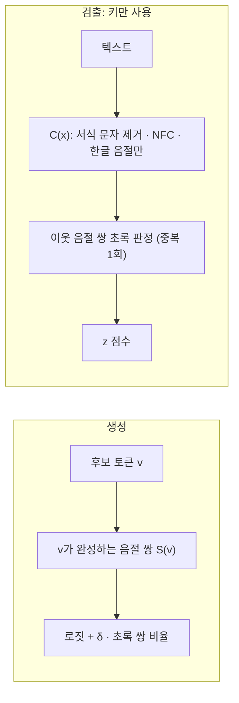

<div align="center">

# Ko-MaJ

**Korean Watermarking by Syllable Juxtaposition**

띄어쓰기를 지워도 남는, 키 하나로 검출하는 한국어 LLM 출력 워터마크

[](LICENSE)


[소개 페이지 · 브라우저 데모](https://mingjaam.github.io/Ko-MaJ/) · [빠른 시작](#빠른-시작) · [실험 결과](#실험-결과) · [실험 재현](experiments/README.md)

</div>

---

## Ko-MaJ는 무엇인가

LLM 워터마크는 모델이 글을 쓸 때 비밀 키로 정한 일부 후보(초록)를 조금 더 자주 고르게 해서, 사람 눈에 보이지 않는 통계적 흔적을 남깁니다. 기존 방법 대부분은 이 규칙을 **토큰** 위에 정의합니다. 그런데 한국어는 띄어쓰기만 바꿔도 토큰 분할이 크게 달라지기 때문에, 의미를 바꾸지 않는 공백 수정만으로 워터마크가 약해집니다. 검출할 때도 그 모델의 토크나이저가 필요합니다.

Ko-MaJ는 초록 규칙을 **이웃한 한글 음절 쌍** 위에 정의합니다.

- **키만으로 검출**: 모델, 토크나이저, 형태소 분석기가 필요 없습니다. 검출기 하나로 여러 모델의 출력을 확인할 수 있습니다.
- **정의상 불변**: 서식 문자 제거와 NFC 정규화를 거친 한글 음절열이 같으면 검출 점수도 같습니다. 띄어쓰기 변경, ZWSP 같은 보이지 않는 문자, 자모 분해(NFD), 재토큰화에 점수가 바뀌지 않습니다.
- **어느 모델에나**: 생성할 때 로짓만 조정하므로 학습이 필요 없고, HuggingFace `transformers`와 vLLM에 바로 붙습니다.



## 빠른 시작

```bash
pip install "git+https://github.com/Mingjaam/Ko-MaJ.git"          # 검출만 (numpy)
pip install "komaj[hf] @ git+https://github.com/Mingjaam/Ko-MaJ.git"  # + transformers 생성
```

### 검출 (키만 필요)

```python
import komaj

r = komaj.detect(text, key=123456789)            # 기본: z > 4 이면 워터마크
print(r)                                          # z = 9.12 over 210 syllable pairs (p = 3.7e-20) -> watermarked
r = komaj.detect(text, key=123456789, max_syllables=200)   # 논문과 같은 200음절 검사
```

```bash
komaj detect --key 123456789 essay.txt
cat essay.txt | komaj detect --key 123456789 --json
```

### 생성: HuggingFace transformers

```python
from transformers import AutoModelForCausalLM, AutoTokenizer, LogitsProcessorList
from komaj.hf import KoMaJLogitsProcessor

tok = AutoTokenizer.from_pretrained("kakaocorp/kanana-1.5-8b-instruct-2505")
model = AutoModelForCausalLM.from_pretrained("kakaocorp/kanana-1.5-8b-instruct-2505", device_map="auto")
inputs = tok.apply_chat_template([{"role": "user", "content": "한국의 사계절을 설명해 주세요."}],
                                 add_generation_prompt=True, return_tensors="pt", return_dict=True).to(model.device)
proc = KoMaJLogitsProcessor(tok, key=123456789, delta=2.5, prompt_len=inputs["input_ids"].shape[1])
out = model.generate(**inputs, do_sample=True, max_new_tokens=400, logits_processor=LogitsProcessorList([proc]))
```

### 생성: vLLM

```python
from vllm import LLM, SamplingParams
from komaj.vllm import KoMaJVLLM

llm = LLM(model="kakaocorp/kanana-1.5-8b-instruct-2505", logits_processors=[KoMaJVLLM])
sp = SamplingParams(temperature=1.0, max_tokens=400, extra_args={"komaj": {"key": 123456789, "delta": 2.5}})
outs = llm.generate(prompts, sp)
```

### 설정 고르기

| 매개변수 | 기본값 | 설명 |
|---|---|---|
| `key` | – | 비밀 키(정수). 공개 저장소의 예시 키를 쓰지 말고 직접 정하세요. |
| `delta` | 2.5 | 세기. 클수록 잘 잡히지만 글이 부자연스러워집니다. 실험에서는 2~3, 작은 모델은 2 이하를 권합니다. |
| `gamma` | 0.25 | 초록 쌍의 비율 |
| `variant` | `h1` | `h1`(앞 1음절 문맥) · `h2`(앞 2음절) · `h2r`(h2 + 반복 문맥 제외, 반복 억제) |
| `threshold` | 4.0 | 검출 z 임계값. 표준정규분포에서 오탐 약 3×10⁻⁵. 운영 환경에서는 같은 길이의 사람 글로 직접 보정하세요. |

## 실험 결과

4개 한국어 LLM, 평가용 위키백과 프롬프트 500개, 앞 200음절, 사람 글 1,500개로 정한 오탐률 약 1% 임계값 기준입니다. 기존 기법은 공식 코드와 공식 검출기를 그대로 썼습니다(계산 비용으로 27B 모델은 제외). 따로 떼어 둔 사람 글 1,500개에서 잰 Ko-MaJ 오탐률은 1.5%(95% 신뢰구간 0.9–2.2%)입니다.

**띄어쓰기를 모두 지웠을 때** (탐지율 %, 공격 없음 → 공백 제거)

| 모델 | Ko-MaJ δ3 | KGW δ2 | Unigram δ2 | SynthID | LUNA | STELA |
|---|---|---|---|---|---|---|
| Qwen2.5-7B | 99 → **99** | 99 → 21 | 98 → 58 | 97 → 2 | 89 → 1 | 100 → 45 |
| EXAONE-3.5-7.8B | 86 → **86** | 87 → 5 | 83 → 11 | 67 → 1 | 45 → 0 | 90 → 3 |
| Kanana-1.5-8B | 75 → **75** | 76 → 4 | 32 → 7 | 53 → 1 | 30 → 2 | 76 → 3 |
| Qwen3.8-27B | 100 → **100** | 99 → 17 | 98 → 36 | – → – | – → – | – → – |

**다른 공격** (탐지율 %, Ko-MaJ δ3 / KGW δ2)

| 모델 | ZWSP | 자모 분해 | 음절 20% 치환 | 음절 20% 삭제 | 문체 변환 | 의역 | 역번역 |
|---|---|---|---|---|---|---|---|
| Qwen2.5-7B | 99 / 43 | 99 / 99 | 95 / 84 | 98 / 93 | 96 / 76 | 32 / 11 | 29 / 12 |
| EXAONE-3.5-7.8B | 86 / 4 | 86 / 1 | 53 / 38 | 72 / 46 | 86 / 85 | 14 / 9 | 18 / 12 |
| Kanana-1.5-8B | 75 / 4 | 74 / 0 | 42 / 32 | 61 / 39 | 75 / 73 | 8 / 9 | 14 / 13 |
| Qwen3.8-27B | 100 / 39 | 100 / 99 | 96 / 82 | 100 / 92 | 100 / 99 | 64 / 38 | 41 / 20 |

자모 분해 열에서 Ko-MaJ가 모델에 따라 공격 전과 ±0.4%p 다른 것은 평가용 접두부 절단이 마지막 음절의 받침을 잘라 생긴 값입니다. 절단은 `komaj.core.cut_at_syllables`에서 수정했고, 바로잡으면 해당 표본의 z가 공격 전과 정확히 일치합니다(표는 재검출 전 값).

**다른 모델의 토크나이저로 검사** (12개 조합): Ko-MaJ 75–100%, KGW·Unigram 0–4%.

**같은 품질 비용으로 맞추면** (KGW δ2와 같은 ΔPPL에서 보간한 탐지율 %, Ko-MaJ / KGW)

| 모델 | 공격 없음 | 문체 변환 | 의역 | 역번역 |
|---|---|---|---|---|
| Qwen2.5-7B | 93 / 99 | 87 / 76 | 14 / 11 | 12 / 12 |
| EXAONE-3.5-7.8B | 80 / 87 | 78 / 85 | 13 / 9 | 17 / 12 |
| Kanana-1.5-8B | 61 / 76 | 59 / 73 | 6 / 9 | 8 / 13 |
| Qwen3.8-27B | 99 / 99 | 99 / 99 | 47 / 38 | 29 / 20 |

### 한계

- 공격이 없을 때 같은 품질 비용에서는 Qwen3.8을 제외한 모델에서 KGW보다 탐지율이 낮습니다.
- 의역과 역번역처럼 음절 자체를 바꾸는 공격에는 모든 기법과 마찬가지로 약합니다.
- 음절을 호환 자모로 풀어 쓰면(한 → ㅎㅏㄴ) 완성형 음절이 없어 검출할 수 없습니다.
- 출력의 한글 비율을 높이는 쪽으로 분포가 바뀌며, 한국어 전용입니다.
- 오탐률은 약 1% 수준까지만 검증했습니다. 해시(SplitMix64)는 암호학적 위조 저항을 주장하지 않습니다.

## 저장소 구성

```
komaj/            패키지: core(정규화·해시) · detection(키만 사용) · schemes(생성 bias) · hf · vllm · cli
experiments/      논문 실험 전체 파이프라인 (생성, 공격, 검출, 평가) → experiments/README.md
docs/index.html   소개 페이지 (GitHub Pages)
examples/         HuggingFace 생성 + 검출 예제
tests/            불변성 테스트
```

## 라이선스

MIT. 비교 기법(SynthID-Text, LUNA, STELA)의 코드는 포함하지 않으며 각 공식 저장소의 라이선스를 따릅니다.
